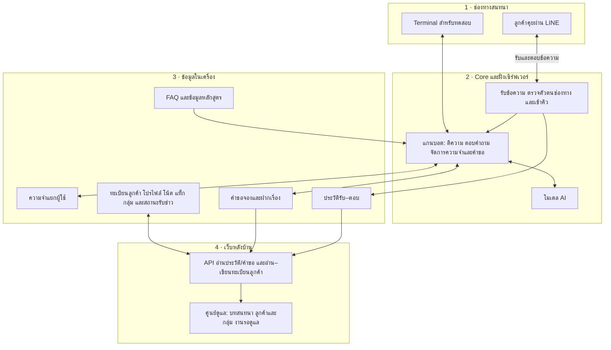

# แผนและสถานะ ซีบอต — CBTU Customer Agent

## ผลตรวจ Google Login จริง — แก้ redirect 1 พฤศจิกายน 2026

เจ้าของอนุญาต Google แล้ว callback ผูกบัญชีได้ พบหน้าแรกหลังredirectถูกปฏิเสธจาก Fetch Metadata จึงแก้เฉพาะ top-level GET / ไม่รวมquery/frame/API/POST/Originอื่น Build+targeted12/12ผ่าน รีสตาร์ต server และตรวจ Google flow จริงถึงหน้า overview ด้วยบทบาทผู้ดูแลระบบแล้ว ข้อความรอ Google consent ในบันทึกรอบก่อนด้านล่างเป็นประวัติ ไม่ปิด M5/M7 หรือ production จากผลนี้ รายละเอียด [GOOGLE_LOGIN_SETUP.md](./GOOGLE_LOGIN_SETUP.md)

## Google Login และตั้งค่าตามบทบาท — 1 พฤศจิกายน 2026

เพิ่มบัญชีเจ้าหน้าที่แยกจากลูกค้า LINE สามบทบาทและสิทธิ์เสริมตาม [SETTINGS_ACCESS_PLAN.md](./SETTINGS_ACCESS_PLAN.md) เชื่อม Google authorization-code flow, session, การปิดบัญชี และตรวจสิทธิ์ทุก API ของเว็บจริง ย้ายหน้าจัดการบอตเป็นตั้งค่า 4 ส่วน ใช้ความรู้/AI/status เดิมต่อและคง history เก่า รองรับ actor เจ้าหน้าที่ที่ยืนยันแล้ว รีสตาร์ต server local แล้ว health200/admin login200/APIไม่มีsession401 ไม่เปลี่ยน ngrok หรือค่าบอต

Full runtime231/231ผ่าน ก่อนแก้ย่อย guard แอดมินที่ผูก Google/recheck session หลังอ่าน upload; หลังแก้ build+targeted12/12ผ่าน Browserfixtureทั้งสามบทบาท เพิ่มบัญชี และmobile390ผ่าน **ยังรอเจ้าของบัญชีกด Google Continue จึงยังไม่ยืนยันล็อกอินบัญชีจริงครบเส้นทาง** ไม่ปิด M5/M7 หรือประกาศ production รายละเอียดใน [GOOGLE_LOGIN_SETUP.md](./GOOGLE_LOGIN_SETUP.md)

## สถานะระบบ — แก้ป้ายยังไม่เคยตรวจหลัง restart 1 พฤศจิกายน 2026

URLหลังrestartถูกต้องแต่ป้ายยังเป็นเทาเพราะผลตรวจในRAMหายและหน้าเดิมไม่เริ่มตรวจเอง แก้ให้เมื่อเปิดภาพรวมหรือผลเกิน5นาทีเริ่มตรวจLINE/HTTPSแบบอ่านอย่างเดียวอัตโนมัติ รับtokenใหม่ได้เมื่อ403หลังrestartโดยไม่reloadหน้า ไม่ส่งข้อความ/เรียกโมเดล/แก้สิทธิ์ Full runtime220/220และtargeted13/13ตามลำดับแก้เล็กในOVERVIEW_GUIDEผ่าน Browserfixtureเปิดครั้งแรก/restartจริงบนพอร์ตเดิม/หน้าเดิมรับtokenใหม่ผ่าน นำขึ้นเว็บจริงแล้ว ตรวจอัตโนมัติServer/LINE/Webhook/ข้อมูลผ่าน ไม่restartngrok ไม่อ้างว่าAIเชื่อมได้จากการตั้งค่า ข้อความตรวจเมื่อกดปุ่มเท่านั้นในรอบ31ต.ค.ด้านล่างเป็นประวัติ

## ภาพรวมและสถานะระบบ — เปิดใช้แล้ว 31 ตุลาคม 2026

เพิ่มแถบServer/LINE/Webhook/AI/ข้อมูลด้านบน ปุ่มตรวจภายนอกอ่านLINE APIและHTTPS ไม่ส่งข้อความ/เปลี่ยนค่า/เรียกโมเดล แสดงหลักฐานเวลาและผลเก่า ตรวจfixture desktop1440/mobile390/ข้อมูลเสีย/API503 และruntime217/217ผ่าน รีสตาร์ตแล้วตรวจเว็บ3001/webhook3000/status API200 ปุ่มตรวจจริงให้LINE API/HTTPS/URLตรงผ่าน AIยังไม่มีผลเรียกหลังเริ่มอย่างตรงไปตรงมา ดูผลล่าสุดท้าย OVERVIEW_GUIDE.md ไม่ปิดM5/M7/production ข้อความรอตรวจภาพ/รอrestartย่อหน้าถัดไปเป็นบันทึกรอบก่อนเพิ่มสถานะ

### บันทึกรอบพัฒนาภาพรวมก่อนเพิ่มสถานะระบบ

เพิ่ม #overview บนเว็บเดิมและเป็นหน้าเริ่มต้น รวมคน/ข้อความวันนี้ตาม Asia/Bangkok งานใหม่/กำลังดูแล คนรอเจ้าหน้าที่ ผู้ทักใหม่รออนุญาต ทะเบียน ผู้คุย/กิจกรรมล่าสุด และผลข่าวจาก delivery จริง พร้อมลิงก์ไปแท็บเดิม API สรุปอ่านอย่างเดียว ไม่เรียกโมเดล ส่งLINE เพิ่มสิทธิ์ หรือเปลี่ยนconsent/ค่าบอต แยกไม่มีข้อมูลกับอ่านไม่ได้ และไม่ถือ accepted ว่าอ่านแล้ว

Build ผ่าน; full runtime208/208, ngrok6/6, import9/9 ผ่านในสภาพแวดล้อมที่ระบุ หลังปรับ aggregation/ข้อความเล็กน้อย build+overview/admin7/7ผ่าน ไม่รันfullซ้ำ **ยังรอตรวจภาพ desktop/mobile** เพราะ Computer Use ไม่ได้รับสิทธิ์ และยังไม่ restart เซิร์ฟเวอร์3001 จึงไม่อ้างว่าเปิดใช้งานจริงหรือปิดM6/production รายละเอียดนิยาม ข้อจำกัดและfixtureใน [OVERVIEW_GUIDE.md](./OVERVIEW_GUIDE.md) ข้อความว่าภาพรวมยังไม่พัฒนาในบันทึก28–29ต.ค.ด้านล่างเป็นประวัติก่อนงานนี้

## ส่งข่าว: ตรวจรับตามขอบเขต local แล้ว — 29 ตุลาคม 2026

เจ้าของทดลองและยืนยันว่ารอบส่งข่าวใช้งานผ่านแล้ว: ข้อความถึงรายคน/ห้อง LINE, รูปหนึ่งรูปพร้อมข้อความ, ตรวจปลายทางและยืนยันส่งเองบนเว็บ และนำข่าวกลับมาใช้ซ้ำด้วยสำเนาที่ไม่คัดลอกผู้รับเดิม แยกกลุ่มลูกค้าจากห้อง LINE ชัดเจน สำเนาเก็บเฉพาะชื่อ/ข้อความ/รูป ต้องเลือกรายคน/กลุ่มลูกค้า/ห้องใหม่และตรวจใหม่ทุกครั้ง ไม่ต้องรอผู้ช่วยปลดสิทธิ์รายข่าวแล้ว

ตรวจ outbox ล่าสุดพบ 5 campaign สถานะ complete และปลายทาง accepted รวม 5 รายการ แต่ละรายการ attempts=1: ข้อความรายคน 1 ข่าว ข้อความเข้าห้อง 1 ข่าว รูปพร้อมข้อความรายคน 2 ข่าว และรูปพร้อมข้อความเข้าห้อง 1 ข่าว เจ้าของยืนยันได้รับข้อความ/รูปและทดสอบสำเนารอบล่าสุดผ่านแล้ว ไม่ใช้ accepted เพียงอย่างเดียวอ้างว่าอ่านแล้ว หรือเหมารวมว่าผู้รับทุกคน/ทุกห้องผ่าน

Build ผ่าน; full runtime 168/168 เป็นรอบก่อนปรับสำเนาให้ผู้รับว่าง หลังปรับจุดนั้นทดสอบชุดส่งข่าวซ้ำ 27/27 และ browser temp/mock ผ่าน ไม่ได้รัน full suite ซ้ำจากการแก้เอกสารนี้ เว็บเดิม3001เปิดโค้ดล่าสุดและhealth200 ตรวจข่าวต้นฉบับไม่เปลี่ยนระหว่างนำโค้ดขึ้น รายละเอียด [NEWS_GUIDE.md](./NEWS_GUIDE.md)

ปิดงานย่อยส่งข่าวใน M6 **ตามขอบเขต local ที่ทดสอบ** ไม่ปิด M5/M7 หรือประกาศ production: ยังไม่ทดสอบส่งครบ1,000ปลายทาง/โหลดมาก/หลายเครื่อง ไม่มี login/hostingถาวร และที่เก็บรูปยังจำกัด200รูป ไม่มีGCอัตโนมัติ ประวัติผลก่อนหน้านี้ด้านล่างคงไว้ตามช่วงเวลา

คำเรียกCBOTล่าสุด: รับprefixต้นข้อความโดยไม่บังคับเว้นวรรค และไม่สนตัวพิมพ์เล็กใหญ่ ตามคำขอเจ้าของเพิ่มเติม เช่น CBOTสมัครเรียนยังไง ใช้ห้องเดิมเท่านั้น

ห้องLINEล่าสุดเพิ่มเติม: เจ้าของเลือกคำเรียกภาษาอังกฤษ CBOT แทนnative mentionเพราะLINEฝั่งผู้ใช้ไม่แสดงบัญชีบอตให้เลือก ตั้งเฉพาะห้องทดสอบเดิม คำเรียกต้องอยู่ต้นข้อความและคั่นจากคำถาม ไม่ต้องใช้@ ยังแยกcore/memoryและไม่เปิดpush ดู LINE_GROUPS_GUIDE.md

ห้องLINEล่าสุด: เจ้าของตกลงให้ตอบเฉพาะแท็กจริง เปิดmention1ห้องทดสอบแล้ว แยกcoreและmemoryตามห้อง/ผู้ส่งจากdirect ไม่รับคำสั่งส่วนตัว/คำขอในกลุ่ม ไม่เปิดpush Build/runtime156/156/browsertempผ่าน ตรวจสถานะliveแล้ว ยังรอยืนยันการแท็กตอบจริงจากเจ้าของ ดู LINE_GROUPS_GUIDE.md

ห้องLINE29ตุลาคม: เปิดแผงห้องจริงแยกจากหมวดลูกค้าในแท็บบทสนทนา ดึงชื่อจริงสำเร็จ1ห้อง เก็บข้อความใหม่แบบอ่านอย่างเดียว ไม่เรียกcore/ส่งreply/pushในกลุ่ม Runtime150/150และbrowsertempผ่าน ตรวจเว็บจริง/ชื่อห้องจริงแล้ว ข้อมูลรายคน/คำขอ/.envไม่เปลี่ยน การรับข้อความใหม่จากผู้ใช้จริงหลังเปิดเก็บยังรอทดสอบ รายละเอียด [LINE_GROUPS_GUIDE.md](./LINE_GROUPS_GUIDE.md)

อัปเดตสถานะ 29 ตุลาคม 2026 ใช้ชื่อเสียงอ่าน “ซีบอต” เท่านั้น รอยืนยัน spelling อังกฤษ

## บทสนทนา: ผลล่าสุด 29 ตุลาคม 2026

เปิดใช้ขอรอเจ้าหน้าที่→รับช่วงด้วยปุ่มเดิม→ส่งข้อความ【Staff】→คืนให้บอตพร้อมบริบทแล้ว เจ้าของยืนยันรับ–ส่งกลับเข้าเว็บ ป้ายStaff และคำขอคุยกับเจ้าหน้าที่ขึ้นรายการรอผ่าน ข้อความขอหยุดบอต/ยกเลิกรอมีแล้วแต่ยังไม่มีผลLINEจริงแยกรายกรณี; การโอนบริบทตรวจpayload/persistenceผ่าน ยังไม่ถือว่าคุณภาพคำตอบจริงครบทุกกรณี

ตารางงานย่อยและสรุปM4/M5/M6ด้านล่างปรับสถานะตามงานที่เสร็จแล้ว แยกฟังก์ชันที่เปิดใช้จากผลLINEจริงที่ยังทดสอบไม่ครบ

แสดงรายการรอ/ตัวกรอง/จำนวนในแท็บบทสนทนา อัปเดตทุก5วินาที ยังไม่มีเสียงหรือแจ้งเตือนนอกเว็บ ไม่แจ้งLINEทีมอัตโนมัติ และไม่เพิ่มข้อความแจ้งตอนรับช่วง/คืนบอต รูปประโยคขอเจ้าหน้าที่ที่ชัดเจนตรวจโดยhostอย่างจำกัด ไม่ให้โมเดลเดาความมั่นใจแล้วส่งต่อเอง

Build/runtimeรอบพัฒนาล่าสุด145/145ผ่านบนworking treeหลังฐาน12a6006; BrowserPlaywright/Chrome tempผ่าน รายละเอียดและขอบเขตผลจริงอยู่ใน [คู่มือบทสนทนา](./CONVERSATIONS_GUIDE.md#ผลยืนยันล่าสุด-29-ตุลาคม-2026) ผลbaseline132/132ด้านล่างเป็นผลก่อนแก้ ไม่ใช่การทดสอบซ้ำวันนี้จากการแก้เอกสาร ไม่แก้BUG-001หรือปิดbacklogproductionจากงานนี้

## ผลทดสอบ baseline ใหม่ 29 ตุลาคม 2026

ตรวจ commit `12a6006` บน main ที่สะอาดตอนเริ่ม: build ผ่าน, runtime132/132 และ import9/9 ผ่านใหม่บน Node25.2.1/Python3.11.8; ผล runtime สุดท้ายรันนอก sandbox เพราะ HTTP tests เปิด loopback ใน sandbox ไม่ได้ CUA/temp settings ผ่าน save→mock trial→review→explicit apply→reload และ FAQ preview ให้ผลตรงกัน แต่พบ BUG-001 ระดับP2: มือถือ390px หลังลอง FAQ หน้าล้น631px ทำซ้ำได้และบันทึกแล้ว ยังไม่แก้โค้ด

เว็บจริง3001อ่าน settings initial/revision0, KM seed/revision0 และข่าวปิดส่ง ณ จุดตรวจ; webhook3000/health200 ไม่ restartหรือเปลี่ยนค่าจริง ไม่เรียกโมเดลจริง/ส่งLINEในรอบนี้ คงผลLINEที่เจ้าของยืนยันรอบก่อน รวมข่าวหนึ่งผู้รับตาม NEWS_GUIDE ไม่อ้างว่าไม่เคยทดสอบ M5/M7ยังทำบางส่วน ไม่ปิดmilestoneจากผลจำลอง รายละเอียด expected/actual/ข้อจำกัดอยู่ใน [ผล baseline](./TEST_BASELINE_2026-10-29.md) และ [ทะเบียนทดสอบ/acceptance](./TEST_PLAN.md) สถานะ28ต.ค.ด้านล่างเป็นหลักฐานรอบก่อน

## สถานะยืนยันล่าสุด 28 ตุลาคม 2026

หลังรวมงานขนาน เปิดใช้เว็บพอร์ต3001แล้ว: ลูกค้าและกลุ่ม บทสนทนา/รับช่วงคุย งานรอดูแล ส่งข่าว และจัดการบอต โดยจัดการบอตมีตั้งค่าการตอบด้านบนและความรู้บอตด้านล่าง หน้า **ภาพรวมยังไม่พัฒนา** จึงไม่ถือว่าทั้งระบบเสร็จ

ผลส่งงานรอบล่าสุดจากแชตจัดการบอต: Build ผ่าน runtime tests132/132 และ import9/9 ผ่าน ตรวจเว็บจอใหญ่/มือถือแล้ว ขั้นเปลี่ยนค่าทดสอบด้วยโมเดลจำลอง ไม่ได้เปลี่ยนprovider/model/promptจริงแทนเจ้าของ ค่าร่างต้องผ่านลอง→ตรวจ→ยืนยันใช้ การกดลองบนเว็บเรียกproviderจริงและใช้quota ตัวเลขtestsเป็นผลรอบส่งงาน ไม่ใช่การรันซ้ำจากการแก้เอกสารนี้

ผล LINE ที่เจ้าของยืนยันไว้: FAQพร้อมลิงก์ ค้น/ดูต่อ ยืนยันคำขอขึ้นเว็บ และอ่านmemory; เคยrestartแล้วความจำยังอยู่และเคยทดลองเป็นกลุ่มแล้ว พฤติกรรม555เลื่อนหน้าเจ้าของยอมรับเป็นข้อสังเกต ชุดพัฒนาบทสนทนา/ส่งข่าว/ตั้งค่ารอบใหม่ใช้ข้อมูลชั่วคราวและtransport/โมเดลจำลอง ไม่เหมารวมว่าเจ้าหน้าที่ตอบหรือcampaignทุกเส้นทางผ่านLINEจริงแล้ว

รายละเอียดแยกตามส่วน: [ลูกค้าและกลุ่ม](./CUSTOMERS_GUIDE.md), [บทสนทนา](./CONVERSATIONS_GUIDE.md), [งานรอดูแล](./COURSE_REQUESTS_GUIDE.md), [ส่งข่าว](./NEWS_GUIDE.md), [ความรู้บอต](./KM_GUIDE.md), [ตั้งค่าการตอบ](./RESPONSE_SETTINGS_GUIDE.md), [บันทึกตรวจเดิม](./CORE_STATUS_AUDIT_2026-10-28.md) ส่วนต่อไปที่เล่าผลเก่าเป็นประวัติ ไม่ใช่สถานะรันล่าสุดทุกย่อหน้า

## ชื่อแสดงจาก LINE

เชื่อม Get profile API ตามคำขอเจ้าของแล้ว แสดงชื่อจาก API ของลูกค้าที่มีอยู่1ราย แยกจากชื่อที่ทีมตั้ง มี cache24ชั่วโมงและปุ่มอัปเดตชื่อ ไม่เปลี่ยนสถานะรับข่าวสารหรือความจำบอต Build/runtime72/72 และ browserผ่าน รอบนี้ไม่ได้ส่งข้อความLINE ข้อจำกัดและผลจริงอยู่ใน CUSTOMERS_GUIDE.md

## Catalog retrieval milestone ล่าสุด

ตามที่เจ้าของอนุญาตให้ดำเนินการหลังวิเคราะห์job/goal-first: สร้างreviewedbriefsครบ20รายการ มีงานตัวอย่าง(ระบุเป็นinferenceจากtopics), outcomes, audience/prerequisitesจริง, หัวข้อสำคัญคัด3–5, รูปแบบ/เวลา และcommercialfieldsแยก ไม่แก้research/runtimecatalogต้นฉบับ ลดคำตอบเริ่มต้น ไม่เทmetadata/ราคา/สถานะทุกครั้ง เพิ่มadvicegoal→background→timeทีละขั้นและrankingที่ไม่เติมweakmatches คงdetailqueries/queryopsและmemoryisolation Tests35รายการผ่านรวมadvicepersistrestart/reset/forget/LINEregression มีCOURSE_BRIEFS.mdให้เจ้าของตรวจและexportscript Restartserverแล้วpublic/LINE Verifyผ่าน ผู้ใช้ลองLINEเบื้องต้นตอบว่าได้อยู่ มีlogok/repliedแต่ยังไม่ถือว่าทดสอบครบทุกadvice stageจริง ไม่มีการเปลี่ยนcredentials/provider/OA/tunnel

ปรับจากhistoryLINEจริงหลังmilestoneแรก: พบrecentตอบไม่ตรงเรื่องราคาแต่ละตัว/จำนวนทั้งหมดและsummaryมีคำขอดูเพิ่ม จึงเพิ่มtypedqueryoperations+semanticplanning พร้อมcatalogcontextแยกmatchset/page/offsetในstoreของแต่ละidentity คงchat/compaction/restartและล้างreset/forget แสดงได้หน้าละ1–10ไม่ใช่cap3 Tests32รายการรวมreplayคำถามจริง/signedLINE/dedupe/persistence/isolationผ่าน Livecoresemanticoperationหนึ่งคำถามผ่าน Restartserverแล้วpublic/LINE Verifyผ่าน ผู้ใช้ลองรายการAI→ราคาแต่ละตัวยืนยันokแล้ว Logปกติ26/11msและmetadataURLsราคาอ้างรายการเดิมตรงกันทั้งหมด matched12/shown3 หลักฐานอ่านhistoryมีขอบเขตและไม่ครอบคลุมfailedturnทั้งหมด ดู LINE_HISTORY_REVIEW.md

เจ้าของอนุญาตใช้ public metadata 19 หลักสูตร+1 bundle จากชุด research แล้ว ตรวจ SOURCE_REPORT/validation/counts/provenance/URLs/flags/nulls และ unverified offers ก่อนสร้าง runtime projection แยก ไม่แก้ shared research ไม่ import บัญชีชำระเงิน/review_required หรือข้อมูล cohort เว็บย่อยที่ยังไม่ยืนยัน เก็บ hash source/report/validation และ field_sources ใน src/course-catalog.ts

ค้นชื่อ/alias/หัวข้อไทยอังกฤษด้วย lexical ranking เลือกสูงสุด3 candidates ให้โมเดลเลือก IDs แล้ว host แสดง facts/citations เปรียบเทียบสองรายการ ถ้ากำกวมถามเพิ่ม ถ้า unknown/null ไม่เดาหรือเหมาว่าไม่มีจริง/ฟรี ถามความสนใจก่อนแนะนำ และใช้ profile ของ identity นั้นเมื่อขอแนะนำตามความสนใจ lastTopic เก็บลำดับที่แสดงเพื่อรองรับ follow-up ไม่ส่ง catalog ทั้งหมดทุก turn มี host fallback/cooldown เมื่อโมเดลล้ม คง memory/credentials/model/OA/tunnel เดิม

Build/tests27รายการผ่าน รวม5 acceptance cases, aliases/รุ่น/follow-up/ID grounding/429/LINE signed mock และ memory regression ทั้งหมด Live core/model หนึ่ง comparison ผ่านไม่มี fallback ผู้ใช้ยืนยันรับ Excel/Canva พร้อมลิงก์ใน LINE แล้ว log ok552ms/replied Public/LINE Verifyผ่าน active=true ข้อมูล snapshot ไม่รับรองราคา/วันเรียน/เปิดรับสด รายละเอียด COURSE_CATALOG_GUIDE.md

## เป้าหมายและขอบเขตที่ปรับแล้ว

ผู้ช่วยผู้สนใจอบรม/ผู้เรียน CBTU ใช้ Pi SDK core เดียวกันผ่าน Terminal สำหรับทดสอบเร็ว และ LINE สำหรับผู้ทดสอบแบบ 1:1 ใช้ knowledge/policy/tools ชุดเดียวกัน ทดสอบ Terminal ก่อนเปิด LINE จริง

ข้อมูลมาจากเว็บไซต์สาธารณะ https://cbtumu.net/ เท่านั้น ไม่ใช้ข้อมูล Notion ภายใน ไม่ถือ mock order เป็นข้อมูลผู้เรียน รุ่นทดลองนี้ตอบ FAQ การสมัคร/เข้าเรียน/เอกสาร/certificate แนะนำหน้าหลักสูตรและช่องทางเจ้าหน้าที่ พร้อม source URL และเวลาเก็บ snapshot

เมื่อข้อมูลไม่พบหรือขัดกันให้บอกตรง ๆ ไม่ยืนยันเวลาอนุมัติ ราคา สถานะเปิดรับสมัคร หรือเลขบัญชีจากข้อมูลที่ยังไม่ตรวจสด บอตชี้ช่องทางหน้า FAQ หรือรับคำขอไว้ในระบบกลางหลังผู้ใช้ยืนยันได้ แต่ยังไม่ส่งต่อหรือแจ้งเจ้าหน้าที่อัตโนมัติ

## ภาพรวมระบบซีบอต — 4 ส่วนหลัก

ส่วนช่องทางสนทนา แกนบอต ข้อมูล และเว็บหลังบ้านมีแล้ว เว็บแก้ทะเบียนลูกค้า ติดตามงาน รับช่วงคุย เตรียมส่งข่าว และจัดการความรู้/ค่าตอบได้ตามขอบเขตในคู่มือ หน้าแผนภาพนี้แสดงเส้นทางหลัก ไม่ได้แสดงAPIเขียนและทุกstoreของฟังก์ชันที่เพิ่มครบทั้งหมด

**สองสายงานพัฒนา:** Core/Backend ดูแลการตอบ ความจำ คิว ข้อมูลและAPI; Frontend ดูแลหน้าศูนย์ควบคุม โดยสั่งงานผ่านBackend ทั้งสองสายใช้ข้อมูลลูกค้าชุดเดียวกัน ไม่ได้เป็นบอตคนละตัว

## งานย่อยและสถานะปัจจุบัน

คงรายละเอียดงานย่อยแบบเดิม และเพิ่มคอลัมน์ **Milestone** เพื่อบอกว่างานนั้นอยู่ในเป้าหมาย M ใด มีตารางสรุป milestone แยกด้านล่างเพื่อดูภาพรวม โดยอ้างอิงงานย่อยชุดนี้

**DONE** = ทำครบขอบเขตที่ระบุ · **PARTIAL** = ทำบางส่วนและยังมีงานค้าง · **TODO** = ยังไม่ทำ สถานะเป็นของงานย่อยในแต่ละแถว ไม่ใช่การประกาศว่าทำผ่านทุก milestone เรียงกันแล้ว

| สถานะ | งานย่อย | Milestone | หลักฐาน / ข้อจำกัด |
|---|---|---|---|
| DONE | Git baseline | M1 | local main เริ่มจาก 31365a3; กัน .env/secrets/build/logs/customer runtime ออก; ไม่มี remote/push |
| DONE | Pi SDK/Terminal | M2 | one-shot `npm start`, แชต `npm run chat`, check/build/tests; Terminal มี bounded persistent memory และ progress/error/timeout |
| DONE | แยก channel/core | M2 | CustomerCore ไม่พิมพ์ stdout เอง รับ trusted identity + callbacks; Terminal/LINE ใช้ core เดียวกัน |
| DONE | ข้อมูลสาธารณะ CBTU ชุดเริ่มต้น | M4 | FAQ/Home/About มี source/capturedAt; deterministic routing สำหรับ FAQ, unknown/conflict; ไม่เรียก Notion ไม่ crawler สด |
| DONE | กติกาซีบอตและ tools | M2 | ชื่อไทย, read-only public knowledge tool และ mock order เดิม; ไม่มี shell/file tools |
| DONE | Memory session isolation/queue | M3 | key แยก channel/OA/direct/user, FIFO รายลูกค้า; ทดสอบ A/B และ Terminal แยกกัน |
| DONE | LINE adapter + mock tests | M6 | raw body HMAC, valid/invalid signature, immediate ACK, in-memory queue/dedupe, allowlist และ mock reply ผ่าน; testsชุดนี้จำลองการส่ง แยกจากผล LINE จริงด้านล่าง |
| DONE | Config/คู่มือ LINE | M6 | .env.example และ LINE_SETUP.md มีแล้ว; credentials/allowlist ตั้งแล้วและรับ–ตอบจริงได้ PUBLIC_BASE_URL ไม่ตั้งใน.env ทำให้ readiness script ไม่ผ่าน ไม่ใช่ข้อสรุปว่าLINEใช้ไม่ได้ |
| DONE | Limits เบื้องต้น | M5 | มีค่าเข้า/ออก/deadline/modelและtool callsที่บังคับฝั่งhost; ปรับร่างและยืนยันใช้ผ่านหน้าตั้งค่าการตอบได้ตามขอบเขต RESPONSE_SETTINGS_GUIDE.md |
| PARTIAL | Logging/cost control | M5 | safe metadata, token/call limits และหน้า monitor มีแล้ว; monetary/daily budget และ billing reconciliation ยังไม่มี |
| PARTIAL | การประเมินคุณภาพ | M5 / M7 | Build/runtimeล่าสุด145/145และbrowserบทสนทนาจอใหญ่/มือถือผ่านในworking tree; import9/9เป็นผลbaselineก่อนแก้ เจ้าของยืนยันรับ–ส่งStaff/ป้าย/ขอรอแล้ว ยังไม่ครอบคลุมทุกprovider/คำถาม/ภาษา/โหลดหรือคุณภาพคำตอบหลังคืนบอตทุกกรณี |
| DONE สำหรับเส้นทางทดลองที่ยืนยัน | LINE end-to-end จริง | M6 | รับ–ตอบ LINE จริงแล้ว; รอบนี้เจ้าของยืนยัน FAQ/ลิงก์/ค้นและดูต่อ/คำขอ/memory และคำขอขึ้นเว็บ ไม่ได้หมายถึงทดสอบทุกเส้นทางหรือ hosting ถาวร |
| DONE สำหรับ Terminal และ LINE local | Persistent memory | M3 | stores/locksแยกdirectory, keyแยกchannel/OA/direct/user,0700/0600,retention90วัน,profile/recent/summary/long-term,resetคงprofileและforgetมีconfirmation; เจ้าของยืนยันอ่านmemoryและเคยrestartผ่าน; ยังไม่ใช่multi-hoststore |
| TODO | Durable queue/dedupe | M5 | ปัจจุบัน restart อาจสูญงานที่ ACK หรือประมวลผล redelivery ใหม่; ยังไม่ production delivery guarantee |
| TODO | Customer verification/ข้อมูลจริง | M3 | LINE identity ไม่เท่ากับสิทธิ์ข้อมูลผู้เรียน; ต้อง map/verify/check ownership ก่อนเพิ่ม real-data tools |
| DONE สำหรับแชต LINE บนเครื่องนี้ | Staffรับช่วงคุยจริง | M4 | รับช่วง/พักบอตเฉพาะราย ส่งข้อความพร้อมยืนยันและป้าย【Staff】 กันตอบซ้อน/ส่งซ้ำ คืนสิทธิ์พร้อมบริบทแล้ว เจ้าของยืนยันStaffส่งและลูกค้าตอบกลับเข้าเว็บ/ป้ายผ่าน; ไม่รวมแจ้งทีมภายนอกหรือรับรองเวลาตอบ |
| DONE สำหรับ snapshot ปัจจุบัน | ค้น/แนะนำหลักสูตรและถามต่อ | M4 | มีข้อมูล19หลักสูตร+1bundle,แหล่งอ้างอิง,briefs,job-first advice,list/count/price/sort/more/read และcatalog contextข้ามrestart; ค้น/ดูต่อLINEจริงผ่าน พฤติกรรม555เลื่อนหน้าเจ้าของยอมรับเป็นข้อสังเกต ไม่ใช่งานแก้รอบนี้ |
| DONE ตามขอบเขตรับฝากคำขอ | รับคำขอจองและฝากเรื่อง | M4 | preview→confirmพร้อมรหัส→บันทึกstoreและเลขอ้างอิง→แสดงหลังบ้านผ่านตามเจ้าของ; ยังไม่ใช่สมัครเรียน ยืนยันที่นั่ง ชำระเงิน หรือส่งเรื่องให้ทีมงานอัตโนมัติ |
| DONE ตามขอบเขตที่พัฒนาแล้ว | เว็บหลังบ้านรวม | M6 | เปิดบทสนทนา ลูกค้าและกลุ่ม งานรอดูแล ส่งข่าว และจัดการบอตแล้ว; ภาพรวมยังไม่พัฒนา การส่งข่าวต้องตรวจรูป/ข้อความ/ปลายทางแล้วกดยืนยันเองบนเว็บ ไม่ส่งอัตโนมัติและไม่ต้องรอผู้ช่วยปลดสิทธิ์แล้ว |
| DONE ตามขอบเขตผู้ใช้บนเครื่อง | ลูกค้าและกลุ่ม | M3 / M6 | รายชื่อ/ค้น/กรอง โปรไฟล์และที่มาแยกช่อง โน้ต2ประเภทพร้อมเวลา/ผู้ทำรายการ/ประวัติแก้ลบ แท็ก หลายกลุ่มและbulkสมาชิก สถานะรับข่าวพร้อมหลักฐาน; storeแยกmemory ไม่มีlogin/สิทธิ์รายเจ้าหน้าที่ ไม่มีข้อมูลตัวอย่างในstoreจริง รายละเอียด CUSTOMERS_GUIDE.md |
| PARTIAL | ทดลองเป็นกลุ่มและสรุปผล | M7 | เจ้าของยืนยันเคยทดลองเป็นกลุ่มแล้ว ยังไม่ได้รวบรวมผลเทียบคำตอบ/เวลาตอบ/error/costและrollbackครบ ไม่ถือว่าไม่เคยทดสอบเพียงเพราะไม่มีบันทึกครบ |
| DONE ตามขอบเขตที่เปิดใช้ | บทสนทนาและบริบทรับช่วง | M4 / M6 | UI3คอลัมน์ ค้นชื่อทะเบียน/LINE โปรไฟล์/โน้ต/งานข้างแชต; คืนบอตพร้อมข้อความลูกค้า/Staff24รายการล่าสุด กรองความลับ แยกโน้ตภายใน คงข้ามrestart/compactionและล้างตามreset/forget ทดสอบpayload/persistenceผ่าน; คุณภาพคำตอบจริงยังอยู่ในงานประเมิน |
| DONE สำหรับคำขอลูกค้าที่ชัดเจน | ขอรอเจ้าหน้าที่แบบผสม | M4 / M6 | ขึ้นรายการรอ/เหตุผล/เวลา/ตัวกรอง/จำนวนในเว็บทุก5วินาที คำขอปกติบอตคุยต่อได้ ขอหยุดบอตจึงพักเฉพาะราย ยกเลิกรอได้และรับช่วงด้วยปุ่มเดิม; เจ้าของยืนยันขอคุย→รายการรอผ่าน ส่วนหยุด/ยกเลิก/ซ้ำ/restartผ่านtestsจำลอง ไม่ให้AIส่งต่อเองจากความมั่นใจ |
| TODO (ยังไม่เลือกรูปแบบทำต่อ) | แจ้งเตือนเจ้าหน้าที่นอกเว็บ | M6 | ปัจจุบันเห็นรายการรอเฉพาะเว็บ ไม่มีเสียง/desktop notification/LINEทีม ต้องกำหนดช่องทาง ผู้รับ และเงื่อนไขก่อนเพิ่มการส่งแจ้งเตือนภายนอก |
| DONE ระดับ local ที่ทดสอบ | งานรอดูแล | M4 / M6 | ค้น/กรอง รับงาน มอบหมาย สถานะใหม่→กำลังดูแล→เสร็จแล้ว โน้ต/timeline และเชื่อมลูกค้า/แชต คงคำขอต้นฉบับ |
| DONE ตามขอบเขต local ที่ทดสอบ | ส่งข่าว | M6 | รายคน/กลุ่มลูกค้า/ห้อง LINE, รูปหนึ่งรูป, review→ยืนยันส่งเอง, ประวัติ/durable outbox และสำเนาเนื้อหาที่ผู้รับว่าง เปิดเว็บเดิมแล้ว เจ้าของตรวจรับ; outbox5ข่าว complete/accepted ปลายทางละ1ครั้ง มีผลรับจริงตามขอบเขต NEWS_GUIDE ยังไม่รับรองโหลด1,000คนหรือproduction |
| DONE สำหรับ FAQ; หลักสูตรอ่านอย่างเดียว | ความรู้บอต (KM) | M4 / M6 | เพิ่ม/แก้/เลิกใช้ร่าง ทดลองคำตอบ ตรวจและยืนยันเผยแพร่ ย้อนเวอร์ชัน; หลักสูตรยังใช้validatorและแสดงหลักฐาน ไม่แก้ข้ามขั้นนำเข้า |
| DONE ตามขอบเขตใช้งาน local | ตั้งค่าการตอบ | M2 / M5 / M6 | provider/model บุคลิก/คำสั่งเพิ่มเติม limits; ร่าง→ลอง→ตรวจและยืนยันใช้→ย้อนเวอร์ชัน; คงกติกาhostที่ล็อก ไม่เผยsecret ไม่เปลี่ยนค่าจริงแทนเจ้าของ Testsรอบล่าสุด132/132+import9/9ผ่าน ใช้โมเดลจำลองตรวจflow |
| DONE ตามขอบเขต local ที่ทดสอบ | หน้าภาพรวมและสถานะระบบ | M6 | รวมข้อมูลจริงและแถบServer/LINE/Webhook/AI/ข้อมูล เปิดโปรเซสจริงแล้ว ตรวจfixture desktop/mobile/partial/API503 และruntime217/217ผ่าน ไม่รับรองproductionหรือเครื่องดับจริง ดู OVERVIEW_GUIDE.md |

ความหมายรหัส: M1 ตั้งต้นและGit · M2 แกนบอตร่วม/กติกา · M3 ความจำ/แยกผู้ใช้/สิทธิ์ข้อมูล · M4 FAQ/หลักสูตร/คำขอและส่งต่อ · M5 ความเสถียร/คุณภาพ/ค่าใช้จ่าย · M6 LINEและเว็บหลังบ้านทดลอง · M7 ทดลองกลุ่ม/สรุปผล

ผลตรวจล่าสุด: [บันทึกตรวจสถานะ 28 ตุลาคม](./CORE_STATUS_AUDIT_2026-10-28.md) รายละเอียดเชิงเทคนิคและประวัติเดิมยังอยู่ในส่วนถัดไป

## สรุป Milestone M1–M7

ตารางนี้สรุปภาพรวมจากงานย่อยด้านบน งานที่อยู่ระหว่างทำไม่ถือว่าเสร็จเพียงเพราะ milestone ถัดไปมีส่วนที่ใช้งานได้แล้ว

| Milestone | เป้าหมาย | สถานะภาพรวม | ทำถึงไหน / เหลืออะไร |
|---|---|---|---|
| **M1** | ตั้งต้นโปรเจกต์และ Git | **ทำแล้วในเครื่อง** | มีประวัติโค้ดและกันข้อมูลลับ; ยังไม่ได้กำหนด remote ซึ่งอยู่นอกขอบเขตเดิม |
| **M2** | แกนบอตร่วมและกติกา CBTU | **ทำแล้วระดับต้นแบบ** | Terminal/LINE ใช้ core เดียวกัน ความรู้สาธารณะและสิทธิ์เครื่องมือชัดเจน |
| **M3** | ความจำ แยกผู้ใช้ และสิทธิ์ข้อมูล | **ทำบางส่วน** | ความจำและการแยกผู้ใช้บนเครื่องนี้ทำแล้ว เจ้าของยืนยันเคยรีสตาร์ตผ่าน; การยืนยันสิทธิ์ข้อมูลผู้เรียนจริงและรองรับหลายเครื่องยังไม่ทำ |
| **M4** | FAQ หลักสูตร คำขอ และส่งต่อทีม | **ทำบางส่วน** | FAQ/หลักสูตร/คำขอ/KM รวมขอรอและStaffรับช่วงในLINEทำแล้ว มีผลเจ้าของยืนยันตามขอบเขต; เหลือcoverage/คุณภาพคำตอบหลังคืนบอตทุกกรณี และเส้นทางแจ้งทีมภายนอกหากเลือกทำต่อ |
| **M5** | ความเสถียร คุณภาพ และค่าใช้จ่าย | **ทำบางส่วน** | มีlimits/error handling/monitor runtimeล่าสุด145/145ผ่าน; import9/9เป็นผลbaselineก่อนแก้ คิวถาวร กันซ้ำข้ามรีสตาร์ตครบทุกevent งบเป็นเงิน และload/fault testsยังค้าง |
| **M6** | เชื่อม LINE และเว็บหลังบ้านทดลอง | **ทำแล้วตามขอบเขตทดลอง** | เปิดบทสนทนา/รอและรับช่วงStaff ลูกค้าและกลุ่ม งานรอดูแล ส่งข่าว และจัดการบอตแล้ว; hostingถาวร login และแจ้งเตือนนอกเว็บยังไม่ทำ; ภาพรวมและสถานะระบบเปิดlocalแล้ว ตรวจfixture desktop/mobile และruntime217/217ผ่าน ส่งข่าวรายคน/ห้องพร้อมรูปและสำเนาผู้รับว่างเจ้าของตรวจรับแล้ว ยืนยันผ่านเว็บได้เองตามreview; ยังไม่รับรองโหลดมาก |
| **M7** | ทดลองเป็นกลุ่มและสรุปผล | **ทำบางส่วน** | เจ้าของยืนยันเคยทดลองเป็นกลุ่มแล้ว; ยังต้องรวบรวมผลเทียบเกณฑ์คำตอบ เวลาตอบ error/cost และrollbackให้ครบ |

M3 มีงานความจำที่ DONE และงานสิทธิ์ข้อมูลจริงที่ TODO จึงสรุปภาพรวมเป็นทำบางส่วน การทำงานคนละส่วนอาจคืบหน้าไม่เรียงตามหมายเลข M

## องค์ประกอบปัจจุบัน

1. **Agent core (`src/core.ts`)** จัดการ session/queue/limits ด้วย trusted channel identity ที่ adapter ให้ ข้อความลูกค้าเปลี่ยน identity หรือเพิ่มสิทธิ์ไม่ได้
2. **Pi engine (`src/agent.ts`)** สร้าง session แบบ in-memory และ explicit resources/tools; ใช้เฉพาะ environment ของโปรเซส ไม่โหลด Pi auth เก่า
3. **Public knowledge (`src/knowledge.ts`)** ข้อมูลคัดสรุปจาก FAQ/Home/About พร้อม capture timestamp ไม่ตีความเวลาเก็บเป็นเวลาที่เว็บแก้ไขล่าสุด คำตอบ FAQ ใช้กติกาค้นข้อความที่ตรวจได้เพื่อลดการแต่งข้อเท็จจริง ส่วน small talk/memory ใช้โมเดล
4. **Terminal (`src/main.ts`, `src/chat.ts`)** ใช้ local tester หนึ่ง session, progress ทุก 5 วินาที, timeout, /exit, /quit, Ctrl-C, EOF
5. **LINE (`src/line.ts`, `src/server.ts`)** รับเฉพาะ text แบบ 1:1 ของ allowlist แยก scope OA/user, ตรวจ raw bytes ก่อน parse, ACK แล้วเข้าคิว; dry run ไม่ส่งข้อความ
6. **Operational controls** บันทึก request ID/channel/outcome/latency ไม่บันทึก raw body, headers, token, user ID หรือเนื้อหาประวัติลง log; model output/call limits และ deadline มีในโค้ด

## กติกาที่ต้องคงไว้

- สิทธิ์อยู่ที่ backend ไม่ใช่การตัดสินของโมเดล ห้ามใช้ชื่อ/เลขออเดอร์ที่พิมพ์เป็นการยืนยันตัวตน
- ไม่โหลดความรู้ภายใน CBTU ให้ customer bot และไม่ให้คำสั่งในเว็บ/ข้อความเพิ่ม tool หรือสิทธิ์
- FAQ ขัดกันเรื่องเริ่มเรียนทันที vs ตรวจเงิน 1–2 วัน และ email บางตอนต่างกัน: ชี้แหล่ง/เจ้าหน้าที่ ไม่เลือกยืนยันเอง
- ราคาหรือเปิดรับสมัครต้องตรวจจากหน้าหลักสูตรล่าสุด ไม่ใช้ snapshot รับรองความพร้อม
- mock order ใช้ DEMO-1001 สำหรับสาธิตเท่านั้น ไม่มี real learner/order API
- LINE replyและStaffรับช่วงในแชตเดิมเปิดตามconfig/allowlistและการยืนยันที่อนุมัติแล้ว ห้ามส่งต่อหรือแจ้งทีมภายนอกเพิ่มโดยยังไม่กำหนดdestination/recipient/ข้อมูลและการอนุญาต การรับช่วง/คืนบอตไม่ส่งข้อความแจ้งเพิ่มตามที่เจ้าของเลือก
- action เปลี่ยนข้อมูลธุรกิจในอนาคตต้องมี preview/confirmation ที่ผูกพารามิเตอร์และผู้ใช้ พร้อมตรวจสิทธิ์ซ้ำก่อน execute
- ไม่เก็บ secrets ใน Git/logs และไม่ขอให้ส่ง credentials ผ่านแชต

## ข้อมูล/การตัดสินใจที่ยังขาด

- LINE OA/tester credentials ตั้งแล้วและมีการลองรับ–ตอบจริง; hosting ถาวรและการบันทึก public endpoint ปัจจุบันยังต้องจัดให้ชัด ไม่ขอ secrets ในแชต
- แหล่ง public knowledge เลือกแล้ว: FAQ/Home/About; ยังต้องให้เจ้าของข้อมูลทบทวนข้อขัดแย้ง อัปเดต snapshot และอนุมัติ coverage ที่ต้องตอบ
- วิธี map/verify learner และ ownership ก่อนใช้ข้อมูลจริง ไม่มีการรวมตัวตนข้ามช่องทางอัตโนมัติ
- Retention และ storage: Terminal demo เก็บไฟล์แบบมีขอบเขตจน inactive เกิน 90 วัน (purge ตอนเปิด/load), Pi active idle 30 นาที; LINE persistence เชื่อมแล้ว; ยังต้องทบทวน production retention ก่อนขยายบริการ
- Staffรับช่วงในLINEแชตเดิมและคำขอรอเปิดใช้แล้ว ส่วนdestination/recipient/การอนุญาตสำหรับแจ้งทีมภายนอกยังไม่กำหนด จึงยังไม่มีการแจ้งเตือนนอกเว็บ
- งบรายวัน/ลูกค้า, คุณภาพและ SLA, persistent queue/dedupe และ monitoring ก่อน production
- Remote Git ยังไม่กำหนด จึงไม่ตั้งหรือ push

## ผลตรวจรอบ CBTU

`npm run build`, `npm test` (10 tests) และ `npm run check` ผ่าน; Terminal conflict FAQ แสดงข้อขัดแย้งพร้อม URL/เวลาเก็บถูกต้อง การรัน server เมื่อ LINE_CHANNEL_SECRET ว่างหยุดพร้อมคำแนะนำตามคาด Tests LINE ใช้ signature/reply/fetch จำลอง ไม่มี production LINE API call ตรวจ HTTP จริงเฉพาะ loopback ด้วย fixtures: health 200, invalid signature 401, valid 200, ส่ง event ซ้ำได้ mock reply ครั้งเดียว รอบนี้ไม่เรียกโมเดลจริงเพิ่ม; ผล live Groq Qwen จากเดโมก่อนหน้ายังแยกจากผล mock รุ่น CBTU

คู่มือการเติม config และตั้ง webhook: [LINE_SETUP.md](./LINE_SETUP.md)

## ผลแก้แชตหลาย turn เพิ่มเติม

ผู้ใช้พบว่าคุยทั่วไปไม่กี่ turn แล้วบอตตอบไม่ได้ ตรวจ PTY จริงพบ routing เดิมส่ง small talk และ follow-up ไป FAQ not_found ทั้งที่โปรเซสไม่ crash และพบ provider HTTP 429 เมื่อส่งเร็วหลายรอบ การทดสอบ 2 turn เดิมไม่ครอบคลุมปัญหานี้

เปลี่ยนเป็น structured Pi dialogue layer สำหรับข้อความที่ไม่ใช่ FAQ ที่ทราบ โดย host render ตัวตน/ข้อมูลธุรกิจ/ลิงก์ ตรวจสถาบันและ domain ผิด จำหัวข้อ FAQ ล่าสุดใน session และเพิ่ม clarification intent ไม่ให้โมเดลเดาข้อเท็จจริงเอง ลด system context/ข้อความซ้ำ ปิด tool loop ระหว่าง dialogue เลือก intent เพิ่ม cooldown เมื่อ 429 และ /reset เพื่อออกจากเพดาน session คำขอที่ล้มเหลวไม่เพิ่มจำนวน turn

Tests ล่าสุด 14 รายการผ่าน รวม malformed/truncated dialogue พร้อมซ่อมหนึ่งครั้งภายใน deadline เดิม, domain/institution guard, contextual topic, isolation/reset และ 429→FAQ ยังใช้ได้→กลับแชตหลัง cooldown ยังไม่ถือว่าพิสูจน์ correctness ทุกประโยคหรือแก้ข้อจำกัดโควตา Groq ได้ รายละเอียดผลจริงใน TERMINAL_TEST_RESULTS.md ไม่มีการเปลี่ยน credentials หรือเรียก LINE ในรอบนี้

## Milestone memory — ตรวจรับแล้ว

เอาการบังคับ reset ทุก20คำตอบออก เก็บ local canonical store ที่ไม่รวม raw Pi transcript/reasoning/errors และคืน context ด้วย Pi SessionManager+compaction entry ใช้ extractive summary ในเครื่องเพื่อลด quota ไม่ใช่ยกเพดานเป็นตัวเลขใหญ่

เก็บ recent 12 คู่ (ย่อเหลือ6), summary/หัวข้อ/เรื่องค้างแบบ bounded, profile จากที่ผู้ใช้บอกชัด และ long-term ที่ขอจำโดยตรง `/reset` ล้าง session context/pending แต่คง profile/long-term; `/forget` ต้อง confirm และ cancel ได้ ลบไฟล์ identity จริงไม่กระทบคนอื่น

Build/tests ล่าสุด18รายการผ่าน รวม >32turn, fake next day และ separate-process restart, identity/channel isolation, reset/no pending revival, forget/no file revival, failed/malformed summary และ429ไม่ล้าง facts, privacy fixtures/permissions/locking/retention ทดสอบ CLI live เพียงสอง model calls: บอกชื่อ514ms และ restartแล้วถามชื่อ370ms จากนั้น24ข้อความ FAQ/greeting พร้อม auto compaction, reset, forget cancel/confirm และ restartอ่าน memory ว่างผ่าน ไม่มีการเปลี่ยน LINE/config/credentials

ข้อจำกัดและ retention implementation: [MEMORY_GUIDE.md](./MEMORY_GUIDE.md) Summary คัดข้อความแบบมีขอบเขตสูญรายละเอียดได้ ไม่ใช่ semantic task manager, filtering เป็น heuristic, disk ไม่เข้ารหัส และ CLI --user ไม่ใช่ customer authentication

## LINE readiness หลังได้รับอนุญาตให้เชื่อมต่อ

ตรวจ .env แบบ presence-only: Channel ID/secret/access token, tester allowlist และ HTTPS base URL ยังขาด, dry run=true, tester0คน ตรวจไม่พบ listener ที่ port3000 และ serverหยุดเมื่อไม่มี secret ตามคาด Build/tests18รายการผ่าน ตรวจ HTTP loopback ด้วย fixtures ผ่าน health200/invalid401/valid200/duplicateหนึ่งmockreply ไม่มีการส่ง LINE จริงหรือเลือก hosting/tunnel

เพิ่ม `npm run line:check` สำหรับตรวจ readiness ที่ไม่แสดงค่า secrets และปรับ LINE_SETUP ให้ตรงกับ core ล่าสุด ยังไม่ต่อ persistent store ให้ LINE ต้องกำหนด OA/HTTPS ก่อนและวาง store แยกพร้อม lifecycle/isolation/reset/forget controls ให้ครบ ไม่อ้างว่า Terminal memory milestone ทำให้ LINE จำข้าม restartแล้ว ขั้นที่ต้องใช้เจ้าของคือเติม config บนเครื่องและเลือก HTTPS hosting; ไม่ส่ง keys ผ่านแชต

### อัปเดตหลังเติม config

ยืนยันผ่าน read-only LINE APIว่า OAชื่อ DemoB1, tokenใช้ได้และchannelตรงกับ.env, allowlist1คนformatถูกต้อง PUBLIC_BASE_URLยังขาด และมีwebhookเดิมactiveบนn8n ไม่ได้ชี้มาที่localserverโดยหลักฐานที่มี จึงยังไม่เปลี่ยนปลายทางหรือเปิดreply

local dry-run serverเริ่มได้แล้ว: health200, unsigned401, signed events=[]200 ไม่ส่งuser event/LINE message ต้องเจ้าของเลือกเส้นทางผ่านn8nเดิมหรือHTTPS hostingก่อนตรวจLINE E2Eและreplyจริง ไม่มีการเปลี่ยนcredentialsหรือTerminal memory

## ผลทดสอบ Terminal ก่อน LINE เพิ่มเติม

ทดสอบ `npm run chat` รุ่น CBTU ผ่าน PTY จริงครบสมัครสมาชิก, ข้อขัดแย้งการเข้าเรียนหลังจ่าย, certificate, ติดต่อเจ้าหน้าที่ และไม่พบข้อมูล ทั้งหมดผ่านพร้อม source/time ตามกติกา ทดสอบความจำผ่านโมเดลจริงสอง turn ในโปรเซสเดียวแล้วตอบชื่อทดสอบตรงกัน (476/441 ms) และ `/exit` ออกด้วย code 0 ไม่มีการเปลี่ยน config หรือเรียก LINE ในรอบนี้ รายละเอียด: [TERMINAL_TEST_RESULTS.md](./TERMINAL_TEST_RESULTS.md)

## เชื่อม DemoB1 ผ่าน HTTPS tunnel

23 ตุลาคม 2026: หลังเจ้าของอนุญาตให้เปิด tunnel/เปลี่ยน webhook ใช้ ngrok ที่ติดตั้งและมี configอยู่ อัปเดตโปรแกรมเป็น3.39.12 เปิดเฉพาะซีบอตพอร์ต3000และปิดrequest inspector ตรวจ public health200/unsigned401/signed-empty200 และ LINE Verify success=true สำรอง webhookเดิมในruntimeที่ignoredและmode0600 แล้วเปลี่ยนปลายทาง อ่านกลับ active=true/URLตรงกัน จากนั้นเปิดreplyจริงเฉพาะallowlist1คนและrestart ตรวจpublic/LINE Verifyซ้ำผ่าน ต่อมารับinboundจริงและlogยืนยันoutcome=replied7ครั้งหลังLINE reply APIสำเร็จ ยังไม่ได้ตรวจหน้าจอผู้รับ ไม่ส่งpush/broadcast ไม่แตะn8nworkflowหรือTerminal memory และLINE memoryยังephemeral

เพิ่ม script สำหรับตรวจ/เปลี่ยน/rollback โดยไม่แสดงsecretsและไม่ทับbackupเดิม วิธีหยุดและคืนปลายทางใน LINE_SETUP.md เครื่อง/server/tunnelต้องเปิดอยู่และURLอาจเปลี่ยน ยังไม่ใช่hostingถาวร

## LINE fallback / provider429

หลังผู้ใช้พบfallback ตรวจcoreจริงพบ Groq HTTP429 ทำซ้ำได้ (modelturnแรกผ่าน แต่followupติดquota; FAQผ่านทันที) ไม่ใช่หลักฐานkey/networkผิด แก้adapterให้บอกquota/FAQและtimeoutอย่างปลอดภัย เพิ่มcategorylogและแยกreplied_fallbackจากreplied ไม่ส่งrawerror ไม่มีproviderretryเพิ่ม ไม่แตะcredentials/model/Terminal store Build/tests20รายการรวมregressionผ่าน Local HTTPและpublicsignature/LINE Verifyผ่าน หลังrestartรับinboundจริงlogmodel_rate_limit/fallbackตามคาด แล้วFAQok2ms/replied ผู้ใช้ยืนยันว่าได้รับFAQแล้ว บทสนทนาผ่านโมเดลยังอาจติดquotaจนproviderปลดข้อจำกัด LINE memoryยังephemeral รายละเอียดstartupoverrideและrollbackใน LINE_SETUP.md

## LINE persistent memory แยกจาก Terminal

ตามการอนุญาตล่าสุด LINEserverใช้MemoryStoreค่าเดียวกับTerminalใน.line-memory แยกdirectory/lockและtrustedidentity ไม่แตะTerminalstoreหรือconfigcredentials เพิ่มLineConversationsเก็บclient/challengeเฉพาะuser/OA/adapter มีidle30นาที/cap100 และmemorycommandsที่ไม่เรียกโมเดล /memoryเป็นsnapshotย่อ /resetคงprofile/long-termล้างpending /forgetต้องconfirm60วินาทีและcancel/ข้อความอื่นยกเลิก ไม่ให้confirmข้ามคน/OA/restart

Build/tests22รายการผ่าน รวมsignedadapter→persistentstore/restart/profile/summary/compaction32turn, OA/user/channelisolation, Terminalอีกprocess/storeเปิดพร้อมLINE, resetpreservesfacts, forgetcancel/expiry/physicaldelete/no-revival/retention และregressionเดิม LocalHTTPmockผ่าน ไม่ใช้ข้อมูลจริงเพื่อdelete tests ServerเปิดstoreจริงและLINE Verifyผ่านหลังrestart ผู้ใช้ส่งชื่อสำเร็จและมีrecord0600จริง จากนั้นrestartและผู้ใช้ส่ง/memoryยืนยันprofileกับrecentยังอยู่จริง ประวัติRAMก่อนเปิดstoreไม่ได้ย้ายอัตโนมัติ คิว/dedupeยังไม่durable

## จัดการบอต: KM และตั้งค่าการตอบ — 28 ตุลาคม 2026

เปิดบนเว็บเดิม3001แล้ว เมนูจัดการบอตอยู่แถวเดียวกับห้าแท็บงานเดิม ภายในตั้งค่าการตอบอยู่บนและความรู้บอตอยู่ล่างเป็นสองsection ไม่มีแท็บย่อย #knowledgeเดิมยังใช้ได้

KMเพิ่ม/แก้/เลิกใช้FAQในร่าง ค้น/ดูความต่าง ลองFAQโดยไม่เรียกโมเดล ตรวจและยืนยันpublishแบบrevision+digest ประวัติและrollback ผ่านactive storeเดียวกันทุกhost/semantic/tool มีlast-goodและsourcevalidation หลักสูตรอ่านอย่างเดียวคงvalidator/evidenceเดิม

ตั้งค่าการตอบเลือกคู่provider/modelจากSDKและสถานะcredentialsโดยไม่เปิดkey แก้presentation preferences/limitsภายใต้policyและhostguardsที่คงที่ ร่าง→ลองโมเดลแบบexplicitใช้quotaในsandbox→ตรวจdiff→ยืนยันapply→version/rollback มีCAS/atomic/lock/last-good เมื่อapplyแล้วงานที่กำลังตอบคงค่าเดิม งานถัดไปทั้งTerminal/LINEใช้ใหม่โดยรักษาcanonicalmemory ไม่ต้องrestartเพื่อapplysettings

Build/regression132/132/import9/9 และbrowsertempdesktop/mobileผ่าน เปิดruntimeแล้วตรวจGET/UIจริงแบบอ่าน active initial/revision0/Qwenเดิม ไม่มีการใช้ค่าร่างทดสอบกับบอตจริง ไม่มีการเรียกproviderหรือส่งLINEจากรอบทดสอบนี้ ไม่อ้างLINEE2Eหรือทุกmodelผ่านจริง รายละเอียดข้อจำกัด [KM_GUIDE.md](./KM_GUIDE.md) และ [RESPONSE_SETTINGS_GUIDE.md](./RESPONSE_SETTINGS_GUIDE.md)

### 1 พฤศจิกายน 2026 — การแบ่งหน้าหลังบ้าน

เพิ่มการแบ่งหน้า/ค้นหาทั้งชุดในรายชื่อลูกค้า บทสนทนา คำขอ ส่งข่าว และรายการตั้งค่าที่โตได้ โหลดแชตเก่าด้วย cursor และรักษาการเลือกสมาชิก/ผู้รับข้ามหน้า Build และเทสต์หลัก 238 รายการผ่าน พร้อมตรวจ browser fixture ดู [รายละเอียดและข้อจำกัด](PAGINATION_GUIDE.md) งานนี้ไม่ถือว่าปิดเกณฑ์ความทนทาน/โหลดจริงของ M5 หรือการทดสอบกลุ่มครบเกณฑ์ M7
