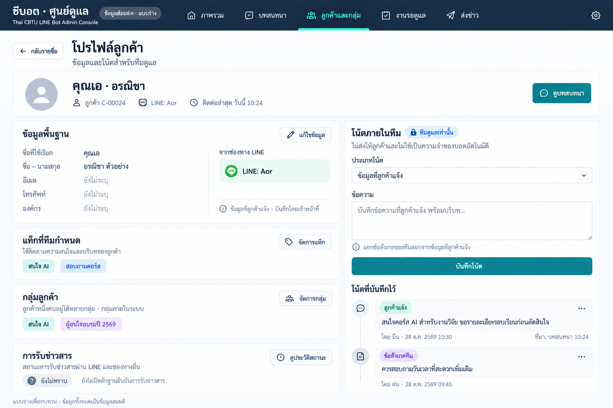
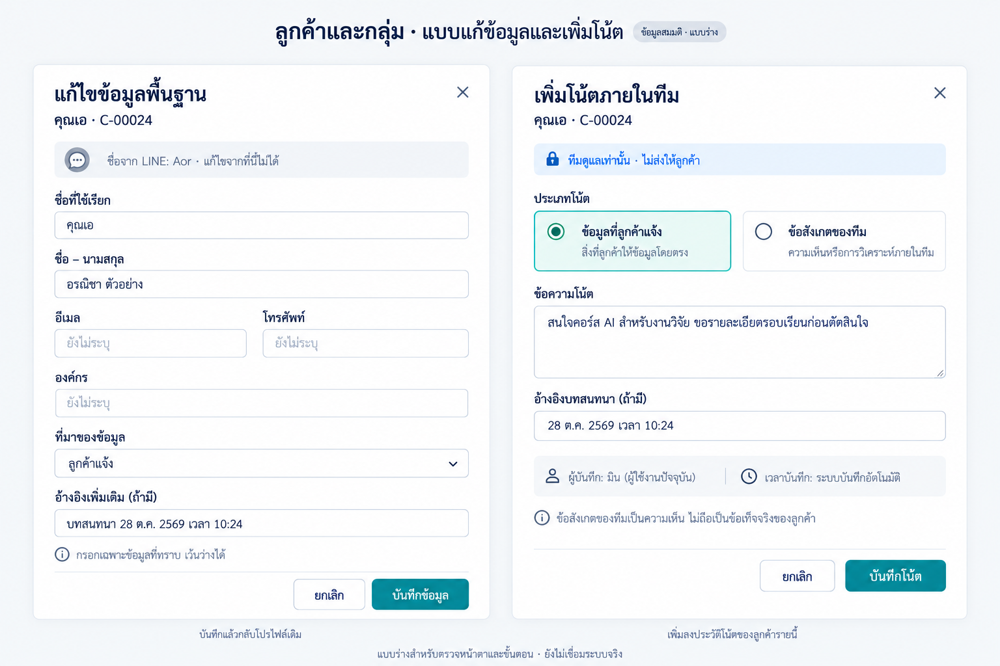

# แบบร่างโปรไฟล์และโน้ตในแท็บลูกค้าและกลุ่ม

28 ตุลาคม 2026 · บันทึกแบบร่างก่อนพัฒนา

สถานะต่อมา: เจ้าของสั่งให้พัฒนาต่อแล้ว และมีระบบลูกค้าและกลุ่มบนเว็บเดิมตาม [CUSTOMERS_GUIDE.md](../../CUSTOMERS_GUIDE.md) ภาพและข้อเสนอด้านล่างเก็บไว้เป็นประวัติการออกแบบ ข้อเสนอเรื่องสิทธิ์เฉพาะผู้เขียนยังไม่ทำ เพราะระบบปัจจุบันไม่มีloginและแสดงข้อจำกัดนี้อย่างชัดเจน

โปรไฟล์เปิดจากรายชื่อลูกค้าภายในแท็บลูกค้าและกลุ่ม แสดงข้อมูลพื้นฐาน แท็ก สมาชิกกลุ่ม สถานะรับข่าวสาร และโน้ตภายในรายคน ภาพใช้ข้อมูลสมมติทั้งหมด ข้อกำหนดด้านล่างเป็นข้อเสนอสำหรับตรวจแบบ ไม่ใช่พฤติกรรมที่ระบบปัจจุบันทำได้แล้ว

## ภาพสำหรับตรวจ

## ขอบเขตที่ยึดไว้

- เมนูหลักคง 5 แท็บ: ภาพรวม, บทสนทนา, ลูกค้าและกลุ่ม, งานรอดูแล, ส่งข่าว
- ลำดับพัฒนา: ลูกค้าและกลุ่ม → บทสนทนา → งานรอดูแล → ส่งข่าว → ภาพรวม
- โปรไฟล์และโน้ตอยู่ภายในลูกค้าและกลุ่ม ไม่เพิ่มเมนูหลัก
- กลุ่มเป็นหมวดหมู่ภายในระบบ ลูกค้าหนึ่งคนอยู่ได้หลายกลุ่ม
- ใช้เว็บเดิมที่ 127.0.0.1:3001 ผ่าน src/admin.ts ต่อไป
- คงประวัติใน .line-monitor และคำขอใน runtime/course-requests; ไม่เติมข้อมูลสมมติลง store จริง
- แบบรอบนี้ไม่เปิด push รับช่วงคุย หรือแก้ LINE config

## การเปิดและกลับจากโปรไฟล์

รายชื่อลูกค้า → คลิกชื่อ → โปรไฟล์รายคน → กลับรายชื่อ โดยจำคำค้น ตัวกรอง หน้าที่เลือก และตำแหน่งเดิม ปุ่มดูบทสนทนาจะนำไปแท็บบทสนทนาพร้อมเลือกลูกค้าคนเดิมในขั้นพัฒนาแท็บนั้น ไม่ใช่ปุ่มรับช่วงคุย

## ข้อมูลพื้นฐาน

| ข้อมูล | การแสดงและการแก้ไข |
|---|---|
| ชื่อที่ใช้เรียก | ทีมแก้ได้; ถ้าว่างใช้ชื่อจากช่องทางเมื่อมี หรือรหัสลูกค้า |
| ชื่อ–นามสกุล อีเมล โทรศัพท์ องค์กร | ทีมแก้ได้และเว้นว่างได้; ไม่เติมข้อมูลจากการคาดเดา |
| ชื่อจาก LINE | แยกจากชื่อที่ทีมตั้ง อ่านอย่างเดียว; ถ้ายังไม่มีข้อมูลให้แสดงยังไม่ทราบ |
| รหัสลูกค้า | ระบบกำหนด อ่านอย่างเดียว; C-00024 ในภาพเป็นตัวอย่าง |
| ติดต่อล่าสุด | มาจากประวัติจริง; ถ้าประวัติไม่อยู่ในช่วงเก็บต้องไม่สร้างเวลาใหม่ |
| ที่มาของข้อมูล | ระบุลูกค้าแจ้งหรือแหล่งที่ทีมตรวจสอบ พร้อมอ้างอิงถ้ามี; การแก้ชื่อเรียกโดยทีมต้องไม่เหมาว่าลูกค้าแจ้ง |

แหล่งที่มา ผู้แก้ และเวลาควรผูกกับแต่ละช่องที่เปลี่ยน ไม่ใช้ข้อความท้ายบัตรเหมารวมว่าทุกช่องมาจากลูกค้า ภาพย่อรายละเอียดส่วนนี้เพื่ออ่านง่าย แบบลงระบบต้องรองรับข้อมูลจากหลายแหล่ง

แก้ไขเปิดกล่องภายในหน้าเดิม ปุ่มบันทึกเปิดเมื่อมีการเปลี่ยนแปลงและข้อมูลผ่านการตรวจ รูปแบบอีเมลผิดแสดงใต้ช่อง เบอร์โทรรองรับ + และรูปแบบที่ใช้งานจริง ไม่บังคับข้อมูลที่ลูกค้ายังไม่ให้ บันทึกสำเร็จจึงปิดกล่องและอัปเดตหน้าจอ หากบันทึกล้มเหลวคงค่าที่กรอกไว้ แสดงข้อผิดพลาดและลองใหม่ได้

ยกเลิกปิดกล่องโดยไม่เขียนข้อมูล ถ้ามีการแก้แล้วยังไม่บันทึกให้เตือนก่อนทิ้งการแก้ไข หากข้อมูลถูกคนอื่นแก้ระหว่างเปิดกล่องให้แจ้งและโหลดฉบับล่าสุดก่อนบันทึก ไม่ทับเงียบ ๆ

## โน้ตภายในทีม

| ส่วนประกอบ | ข้อเสนอพฤติกรรม |
|---|---|
| ประเภท | ลูกค้าแจ้ง / ข้อสังเกตทีม; ต้องเลือกอย่างชัดเจน ไม่ใช้ AI แยกแทน |
| ข้อความ | ข้อความธรรมดา ไม่รับโน้ตว่าง; จำกัดความยาวพร้อมตัวนับในแบบลงระบบ |
| อ้างอิง | ผูกข้อความสนทนาจริงเมื่อมี หรือระบุบริบทด้วยมือโดยแสดงว่าเป็นข้อความอ้างอิงที่ทีมกรอก |
| ผู้บันทึก | มาจากตัวตนเจ้าหน้าที่ที่เข้าสู่ระบบ ไม่ใช่ช่องกรอกชื่ออิสระ |
| เวลา | เซิร์ฟเวอร์กำหนด; เก็บเวลามาตรฐาน แสดงเวลาไทยพร้อมวันเดือนปี |
| รายการ | เรียงใหม่สุดก่อน แสดงประเภท ผู้บันทึก เวลา และแหล่งอ้างอิงในแต่ละรายการ |
| การแก้ไข | ข้อเสนอให้ผู้เขียนแก้ของตนเองได้ พร้อมคำว่าแก้ไขแล้วและประวัติฉบับก่อน |
| การลบ | ข้อเสนอให้ยืนยันก่อนลบและเก็บร่องรอยผู้ลบ/เวลา; กติกาสิทธิ์ต้องออกแบบร่วมกับตัวตนเจ้าหน้าที่ |

ภาพแรกแสดงแบบเพิ่มโน้ตในหน้า ภาพที่สองขยายรายละเอียดฟอร์มเดียวกันสำหรับตรวจช่องกรอก แนวทางที่เสนอคือใช้ฟอร์มในหน้าเป็นหลัก ไม่สร้างฟอร์มสองชุดที่กติกาต่างกัน

โน้ตไม่ส่งให้ลูกค้า ไม่เติมเข้า memory หรือ prompt ของบอตอัตโนมัติ ไม่ใช้คาดเดาโอกาสซื้อ และไม่ทำให้ข้อสังเกตทีมกลายเป็นข้อมูลที่ลูกค้ายืนยัน ขณะบันทึกปิดปุ่มซ้ำ; เมื่อสำเร็จค่อยล้างฟอร์มและเพิ่มรายการใหม่ หากล้มเหลวต้องรักษาข้อความไว้

เว็บปัจจุบันยังไม่มีตัวตนเจ้าหน้าที่ที่ตรวจยืนยัน การมีชื่อและตราทีมดูแลในภาพเป็นเป้าหมายการออกแบบ การจำกัดสิทธิ์ต้องทำที่เซิร์ฟเวอร์ด้วยก่อนถือว่าเป็นโน้ตเฉพาะทีมที่พร้อมใช้งาน

## แท็ก กลุ่ม และการรับข่าวสาร

แท็กใช้บอกบริบทที่ทีมกำหนด ส่วนกลุ่มใช้รวบรวมรายชื่อเพื่อดูแล แต่ละคนมีหลายแท็กและหลายกลุ่มได้ การเอาออกจากกลุ่มไม่ลบลูกค้า ประวัติ โน้ต หรือคำขอ

ข้อเสนอรอบแรกให้ทีมเพิ่มและนำสมาชิกออกเอง ไม่มีเงื่อนไขเพิ่มเข้ากลุ่มอัตโนมัติตามแท็กที่ปรากฏในภาพแนวคิดเดิม กล่องจัดการกลุ่มควรค้นหา เลือกหลายกลุ่ม และบันทึกการเปลี่ยนแปลงร่วมกัน การสร้างกลุ่มใหม่ต้องไม่ทำให้ได้สถานะรับข่าวสารโดยอัตโนมัติ

การรับข่าวสารแยกเป็น ยังไม่ทราบ / รับข่าวสาร / ไม่รับข่าวสาร พร้อมแหล่งที่มาและเวลา แยกจากสถานะช่องทาง LINE ที่ติดต่อได้หรือบล็อกอยู่ ไม่ตีความว่าเพิ่มเพื่อนหรือมีแท็กเท่ากับยินยอมรับข่าว ไม่มีสวิตช์เปลี่ยนเป็นรับข่าวโดยไม่มีหลักฐาน และปุ่มดูประวัติเป็นการอ่านข้อมูล

## สถานะหน้าจอที่ต้องรองรับ

| สถานการณ์ | สิ่งที่แสดง |
|---|---|
| กำลังโหลด | โครงร่างบัตรและข้อความกำลังโหลด; ไม่แสดงค่าตัวอย่างแทนข้อมูลจริง |
| ยังไม่มีโน้ต | ยังไม่มีโน้ตของลูกค้ารายนี้ พร้อมฟอร์มเพิ่ม |
| ไม่มีแท็กหรือกลุ่ม | ยังไม่มีแท็ก / ยังไม่อยู่ในกลุ่ม พร้อมปุ่มจัดการ |
| โหลดไม่ได้ | ข้อผิดพลาดและลองใหม่; ไม่ใช้หน้าว่างแทนคำอธิบาย |
| ไม่พบลูกค้า | ไม่พบลูกค้ารายนี้ พร้อมกลับรายชื่อ |
| ไม่มีสิทธิ์ | ปิดการเข้าถึงข้อมูลฝั่งเซิร์ฟเวอร์และแสดงสถานะชัดเจน |
| หน้าจอแคบ | เรียงข้อมูลพื้นฐาน → แท็ก → กลุ่ม → รับข่าวสาร → โน้ต เป็นคอลัมน์เดียว |

การใช้คีย์บอร์ดต้องเปิด/ปิดกล่องได้ โฟกัสเข้ากล่องและคืนปุ่มเดิมเมื่อปิด มี label ทุกช่อง และใช้ข้อความร่วมกับสีในการแยกประเภทโน้ต

## จุดเชื่อมกับของเดิม

src/admin.ts รวม monitor กับ requests อยู่แล้ว โดย monitor มี account และ userId เป็นข้อมูลอ้างอิงการสนทนา ข้อมูลลูกค้าใหม่ต้องอ้าง trusted identity แบบมี channel/account/user ไม่จับคู่ด้วยชื่อแสดง และไม่รวมข้าม OA ด้วย userId เพียงอย่างเดียว

เสนอ store สำหรับข้อมูลดูแลลูกค้าแยกจาก memory ของบอต และไม่เขียนย้อนทับ .line-monitor หรือ runtime/course-requests ชื่อ LINE ในภาพต้องมีเส้นทางดึงข้อมูลจริงรองรับ; monitor ปัจจุบันไม่ได้ยืนยันว่ามีชื่อแสดงดังกล่าว

## เกณฑ์ตรวจแบบก่อนลงระบบ

- เปิดโปรไฟล์และกลับได้โดยไม่เสียคำค้น/ตัวกรอง
- ฟอร์มแก้ข้อมูลแยกชื่อจาก LINE กับชื่อที่ทีมแก้ และเว้นข้อมูลที่ไม่ทราบได้
- โน้ตแยกสิ่งที่ลูกค้าแจ้งกับข้อสังเกตทีม มีผู้บันทึกและเวลาจริง
- การแก้โปรไฟล์กับโน้ตไม่เปลี่ยนความจำของบอตโดยปริยาย
- การจัดกลุ่มไม่ลบข้อมูลเดิม และไม่เปลี่ยนการรับข่าวสาร
- กติกาบันทึก ล้มเหลว ยกเลิก แก้พร้อมกัน และสิทธิ์เจ้าหน้าที่ชัดเจนก่อนเปิดการเขียนจริง

ส่วนรายชื่อ/ค้นหา หน้าจัดการกลุ่ม สร้างกลุ่ม เพิ่ม/นำสมาชิกออก และประวัติสถานะรับข่าวสารยังต้องเติมภาพรายละเอียดต่อ จึงยังไม่ถือว่าปิดการออกแบบทั้งแท็บ

## ข้อมูลภาพ

สร้างด้วยเครื่องมือ image_gen ในตัวผ่าน skill imagegen ภาพแรกอ้างภาพแนวคิดลูกค้าและกลุ่มเดิมด้านโทนและเมนู ภาพสองอ้างภาพแรกด้านสไตล์

ข้อกำหนดภาพแรก: หน้าจอโปรไฟล์ในเมนูหลัก 5 แท็บ โทนน้ำเงินเข้ม/ขาว/teal ข้อมูลพื้นฐานและแหล่งที่มา แท็ก หลายกลุ่ม สถานะรับข่าวที่ยังไม่ทราบ โน้ตแยกลูกค้าแจ้งกับข้อสังเกตทีมพร้อมผู้บันทึก/เวลา และข้อมูลสมมติทั้งหมด

ข้อกำหนดภาพสอง: แบบฟอร์มแก้ข้อมูลกับแบบฟอร์มเพิ่มโน้ตวางคู่กัน ชื่อ LINE อ่านอย่างเดียว ช่องพื้นฐานเว้นว่างได้ ที่มาข้อมูล/อ้างอิง ประเภทโน้ตสองแบบ ตัวตนผู้บันทึกจากระบบ เวลาอัตโนมัติ ปุ่มยกเลิก/บันทึก และไม่มีการส่งข้อความจริง
